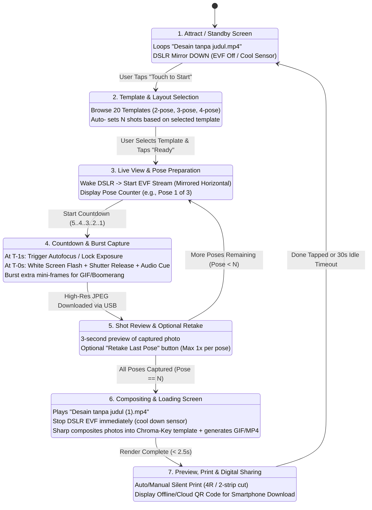
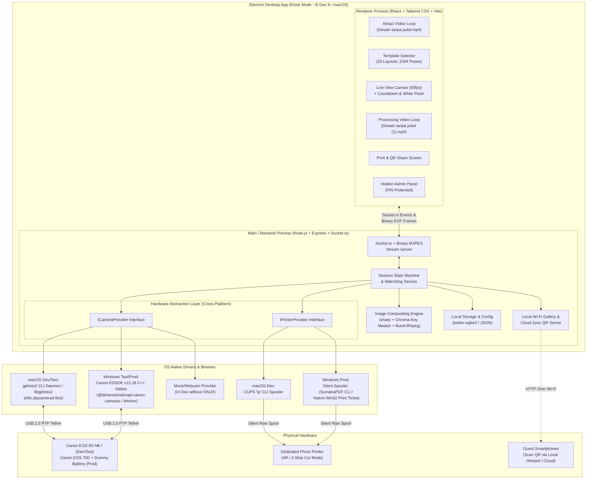
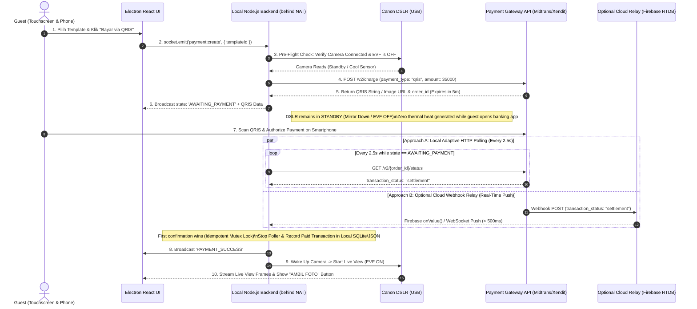
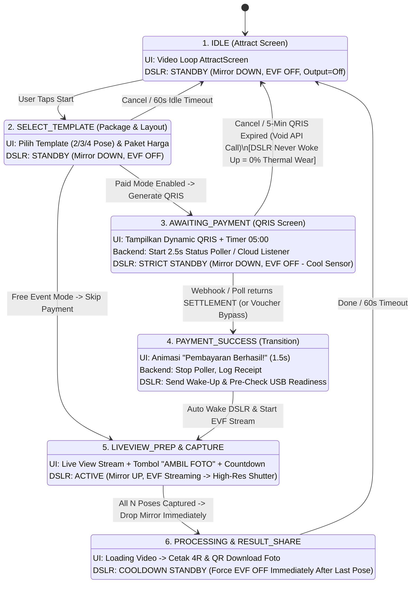

# Professional DSLR Photobooth — System Architecture & Project Plan

## 1. Executive Summary & Environment Matrix

Aplikasi **Professional DSLR Photobooth** ini dirancang sebagai **Local Desktop Web-App (Electron Kiosk + Node.js Backend)** yang menggabungkan fleksibilitas UI berbasis web modern dengan akses hardware tingkat rendah (kontrol kamera DSLR Canon via USB & pencetakan otomatis tanpa dialog / *silent printing*).

### Target Environments & Hardware Pipeline
| Stage | OS / CPU | Camera Hardware | Power / Peripherals | Primary Goal |
| :--- | :--- | :--- | :--- | :--- |
| **1. Development** | macOS (Apple Silicon M-Series) | Canon EOS 6D Mark I | Battery / AC Adapter, Local Mock/CUPS Printer | UI/UX development, DSLR tether & Live View integration, Image compositing engine |
| **2. Testing / QA** | macOS & Windows 10/11 | Canon EOS 6D Mark I | USB Tether Cable + Suppressor, Test Printer | Cross-platform HAL verification, stress-testing USB recovery & memory leak checks |
| **3. Production** | Windows 10/11 (PC AIO Touchscreen i5 Gen 6) | Canon EOS 70D | **Dummy Battery (AC-E6 / DR-E6)** + Dedicated Photo Printer (maybe DNP / HiTi / Canon / Epson)- for printer is still not confirmed | Fullscreen Kiosk Operation, High-throughput event stability (6–12 hours nonstop) |

---

## 2. Task 1: Competitor Analysis & Feature Mapping

Analisis mendalam terhadap tiga perangkat lunak photobooth standar industri (**dslrBooth**, **Darkroom Booth**, dan **Breeze Systems DSLR Remote Pro**) menjadi acuan arsitektur sistem ini.

### 2.1 Competitor Benchmark Matrix
| Capability | dslrBooth | Darkroom Booth | Breeze DSLR Remote Pro | Our Target Architecture |
| :--- | :--- | :--- | :--- | :--- |
| **UI Rendering** | Native WPF | Native Windows | Native / Custom Skins | **React + Tailwind CSS (60fps Hardware Accelerated in Electron Kiosk)** |
| **Template System** | Built-in Editor (Layering + Transparency) | Proprietary `.xbdr` templates | XML + PNG Overlay | **Auto Chroma-Key Green (`#00FF00`) Alpha Pre-processor + JSON Slot Detector** |
| **Live View Latency** | Low (~30fps EDSDK) | Low (~30fps EDSDK) | Ultra-Low (Direct EDSDK) | **< 40ms MJPEG Binary Stream over WebSocket / Custom Protocol** |
| **DSLR Reliability** | Good (Consumer-friendly) | High (Professional) | Industry Gold Standard | **Finite State Machine (FSM) Watchdog + Thermal EVF Guard + USB Auto-Reconnect** |
| **Silent Printing** | Windows Print Driver | Direct Windows Spooler / SDK | Windows Spooler | **Cross-platform Spooler CLI (`SumatraPDF` / GDI+ on Win, `lp` CUPS on macOS)** |

---

### 2.2 Standard Touchscreen Photobooth User Flow



#### Rincian 7 Tahap User Flow:
1. **Attract / Standby Screen (`IDLE` State)**:
   - Memutar video loop penuh layar dari [`template/Desain tanpa judul.mp4`](file:///Users/euxia/Project/Node/photobooth/template/Desain%20tanpa%20judul.mp4) dengan tombol CTA interaktif ("Tap Anywhere to Start").
   - Kamera DSLR berada dalam mode *Standby* (Live View / EVF mati, cermin turun) untuk menjaga suhu sensor tetap dingin.
   - Terdapat *Hidden Operator Hotspot* (mis. tap 5x di pojok kiri atas + PIN) untuk membuka Admin Dashboard.
2. **Template Selection (`SELECT_TEMPLATE` State)**:
   - Pengguna memilih dari 20 desain template yang tersedia di folder [`template/`](file:///Users/euxia/Project/Node/photobooth/template).
   - UI mengelompokkan atau menampilkan indikator jumlah pose secara otomatis berdasarkan template:
     - **2-Pose Layout**: [`18.png`](file:///Users/euxia/Project/Node/photobooth/template/18.png)
     - **3-Pose Layout**: [`1.png`](file:///Users/euxia/Project/Node/photobooth/template/1.png), [`2.png`](file:///Users/euxia/Project/Node/photobooth/template/2.png), [`3.png`](file:///Users/euxia/Project/Node/photobooth/template/3.png), [`5.png`](file:///Users/euxia/Project/Node/photobooth/template/5.png), [`6.png`](file:///Users/euxia/Project/Node/photobooth/template/6.png), [`7.png`](file:///Users/euxia/Project/Node/photobooth/template/7.png), [`8.png`](file:///Users/euxia/Project/Node/photobooth/template/8.png), [`9.png`](file:///Users/euxia/Project/Node/photobooth/template/9.png), [`10.png`](file:///Users/euxia/Project/Node/photobooth/template/10.png), [`11.png`](file:///Users/euxia/Project/Node/photobooth/template/11.png), [`12.png`](file:///Users/euxia/Project/Node/photobooth/template/12.png), [`13.png`](file:///Users/euxia/Project/Node/photobooth/template/13.png), [`14.png`](file:///Users/euxia/Project/Node/photobooth/template/14.png), [`16.png`](file:///Users/euxia/Project/Node/photobooth/template/16.png), [`17.png`](file:///Users/euxia/Project/Node/photobooth/template/17.png)
     - **4-Pose Layout**: [`4.png`](file:///Users/euxia/Project/Node/photobooth/template/4.png), [`15.png`](file:///Users/euxia/Project/Node/photobooth/template/15.png), [`19.png`](file:///Users/euxia/Project/Node/photobooth/template/19.png), [`20.png`](file:///Users/euxia/Project/Node/photobooth/template/20.png)
3. **Live View & Countdown (`LIVEVIEW_COUNTDOWN` State)**:
   - Kamera mengaktifkan Live View (`EVF`). Stream video ditampilkan secara *horizontally mirrored* (`scaleX(-1)`) agar natural seperti cermin, dengan *framing guide* sesuai proporsi slot foto pada template yang dipilih.
   - Hitung mundur visual & suara (5-4-3-2-1). Selama 2 detik terakhir, backend menangkap *burst frame* dari Live View untuk bahan Boomerang/GIF.
4. **Photo Capture (`CAPTURING` State)**:
   - Saat angka `0`, layar menampilkan *White Screen Flash* penuh (membantu pencahayaan wajah) bersamaan dengan perintah shutter DSLR.
   - File JPEG resolusi tinggi langsung diunduh dari buffer RAM kamera ke PC via USB (tanpa wajib memenuhi SD Card) dalam waktu < 1.2 detik.
5. **Shot Review & Optional Retake (`REVIEW_SHOT` State)**:
   - Menampilkan hasil jepretan selama 3 detik. Jika fitur *Retake* diaktifkan di Admin, pengguna punya waktu 3 detik untuk menekan tombol "Ulangi Foto Ini" sebelum lanjut ke pose berikutnya.
6. **Processing & Layouting (`PROCESSING` State)**:
   - Segera setelah pose terakhir diambil, **Live View DSLR dimatikan** agar sensor kamera dingin.
   - Layar memutar animasi loading [`template/Desain tanpa judul (1).mp4`](file:///Users/euxia/Project/Node/photobooth/template/Desain%20tanpa%20judul%20(1).mp4).
   - Di latar belakang, Image Processing Engine menggabungkan foto ke semua slot kiri & kanan (duplikat 2-up strip pada kanvas `1333x1999`), menerapkan filter (Original, B&W, Vintage, Bright), serta membuat video Boomerang MP4/GIF.
7. **Print & QR Digital Sharing (`PRINT_AND_SHARE` State)**:
   - Menampilkan hasil akhir kolase foto dan preview Boomerang.
   - Mengirim perintah **Silent Print** ke Windows Print Spooler (1 lembar 4R = 2 strip foto 2x6 inci).
   - Menampilkan **QR Code** untuk unduh digital instan (mendukung mode *Local Wi-Fi Hotspot* tanpa internet maupun *Cloud Sync* saat ada internet).

---

### 2.3 Must-Have Features & Analysis of Existing `template/` Assets

#### Temuan Penting pada Aset `template/` (`1.png` – `20.png`):
Berdasarkan inspeksi teknis terhadap ke-20 file PNG di folder [`template/`](file:///Users/euxia/Project/Node/photobooth/template):
1. **Dimensi & Format**: Semua file berukuran **`1333 x 1999` piksel** (rasio aspek `2:3` / ukuran cetak kertas foto **4R / 4x6 inci pada ~333 DPI**) dengan format **2-Up Duplicate Strip** (kolom kiri dan kolom kanan identik, dirancang untuk dipotong tengah menjadi 2 strip foto `2x6 inci`).
2. **Tanpa Alpha Channel (`hasAlpha: no`) — Chroma-Key Green Slots**:
   - Seluruh 20 template adalah RGB PNG tanpa transparansi (`hasAlpha: no`), di mana area slot foto ditandai dengan warna **Chroma-Key Green** (baik hijau solid `#00FF00` seperti pada [`1.png`](file:///Users/euxia/Project/Node/photobooth/template/1.png), [`2.png`](file:///Users/euxia/Project/Node/photobooth/template/2.png), [`6.png`](file:///Users/euxia/Project/Node/photobooth/template/6.png), [`7.png`](file:///Users/euxia/Project/Node/photobooth/template/7.png) maupun hijau bertekstur watercolor pada [`10.png`](file:///Users/euxia/Project/Node/photobooth/template/10.png)–[`20.png`](file:///Users/euxia/Project/Node/photobooth/template/20.png)).
   - **Non-Rectangular & Overlapping Stickers**: Beberapa template memiliki bentuk slot non-persegi panjang (mis. bentuk bunga/cloud, kotak, dan oval dengan stiker bintang menumpuk di atas slot pada [`6.png`](file:///Users/euxia/Project/Node/photobooth/template/6.png), bentuk bingkai oval/renda pada [`12.png`](file:///Users/euxia/Project/Node/photobooth/template/12.png) & [`18.png`](file:///Users/euxia/Project/Node/photobooth/template/18.png), serta stiker pita/ceri/bintang yang menjorok ke dalam area foto pada [`4.png`](file:///Users/euxia/Project/Node/photobooth/template/4.png), [`5.png`](file:///Users/euxia/Project/Node/photobooth/template/5.png), [`9.png`](file:///Users/euxia/Project/Node/photobooth/template/9.png), [`14.png`](file:///Users/euxia/Project/Node/photobooth/template/14.png), [`15.png`](file:///Users/euxia/Project/Node/photobooth/template/15.png)).
   - **Anomali Template [`8.png`](file:///Users/euxia/Project/Node/photobooth/template/8.png)**: Pada `8.png`, terdapat kotak hijau besar di layer depan yang menutupi area tengah template. Pre-processor template kita akan mendeteksi dan memperbaiki atau menandai `8.png` di Template Manager.

#### Solusi Teknis: Automated Chroma-Key Template Pre-Processor
Agar stiker/ornamen yang menumpuk di atas frame hijau tetap berada **di depan foto** dan bentuk oval/bunga terpotong rapi:
- Sistem menyertakan **Chroma-Key Pre-Processor (`sharp` + HSV Flood/Connected-Component Scanner)** yang dijalankan saat startup/import template:
  1. Memindai piksel dengan dominansi warna hijau ($G > 150$, $G - R > 60$, $G - B > 60$) dan mengubahnya menjadi **Alpha Transparan (`alpha = 0`)** dengan *edge feathering / anti-aliasing* 1.5px agar pinggiran stiker dan bingkai oval halus tanpa *green fringe*.
  2. Melakukan *Connected-Component Labeling (Blob Detection)* pada area transparan untuk menemukan **Bounding Box `(x, y, width, height)`** setiap slot foto di kolom kiri (`L1..Ln`) dan kolom kanan (`R1..Rn`), lalu menyimpannya ke `templates.manifest.json`.
  3. Saat sesi pemotretan selesai, foto ke-$i$ di-*crop* (`cover` center-crop) sesuai ukuran slot `Li` dan `Ri`, diletakkan di **Layer Bawah**, lalu gambar template yang sudah ber-alpha transparan ditumpuk di **Layer Atas**. Hasilnya: bentuk oval, bunga, maupun stiker ceri/bintang otomatis memotong dan menutupi foto dengan sempurna!

---

### 2.4 Best Practices for DSLR State Management (Preventing Crashes in Long Events)

Pada event berdurasi 6–12 jam nonstop menggunakan **Canon EOS 6D Mark I** dan **Canon EOS 70D**, penyebab utama kamera *hang/freeze* (`Err 20`, `Err 70`, `Err 80`, atau *USB Busy lockup*) adalah panas berlebih (*thermal shutdown*) akibat Live View menyala terus-menerus dan konflik antrean perintah PTP USB.

1. **Strict EVF (Live View) Thermal Duty-Cycling**:
   - **JANGAN PERNAH** menyalakan Live View DSLR saat berada di layar Attract/Standby, Template Selection, Processing, atau Print/Share.
   - Live View hanya diaktifkan saat masuk ke `LIVEVIEW_COUNTDOWN` dan **wajib langsung dimatikan (`StopEvf`)** tepat setelah pose terakhir selesai diambil. Ini memangkas waktu nyala sensor hingga 70% dan mencegah *thermal shutdown* pada Canon 70D.
2. **Serialized Command Queue & Single-Flight Mutex**:
   - Protokol USB PTP Canon tidak *thread-safe*. Jika aplikasi meminta frame Live View (`EdsDownloadEvfImage`) pada milidetik yang sama saat mengirim `TakePicture`, kamera akan mengalami *Bus Lockup* (harus cabut baterai).
   - Solusi: Bungkus seluruh akses kamera dalam **Single-Thread Serialized Command Queue**. Sebelum `TakePicture` dipanggil, loop polling `EvfFrame` **wajib di-pause dan di-await** hingga frame terakhir selesai di-drain.
3. **Autofocus (AF) Fail-Safe & Manual Focus Lock**:
   - Pada Canon 6D / 70D, jika lensa berada di mode `AF` dan gagal mengunci fokus (mis. tamu terlalu dekat atau backdrop gelap), perintah `TakePicture` akan *stuck* (`DEVICE_BUSY`).
   - Best Practice: Gunakan **Manual Focus (`MF`)** pada lensa yang sudah dikalibrasi ke jarak sofa/backdrop photobooth dengan aperture `f/5.6 – f/8` (Depth of Field tebal), ATAU konfigurasi SDK untuk mengirim perintah `PressShutterButton(Completely_NonAF)` jika AF timeout setelah 800ms.
4. **Direct-to-PC RAM Transfer (`SaveTo.Host`)**:
   - Set properti kamera `kEdsPropID_SaveTo = kEdsSaveTo_Host` (atau `Both` jika ingin backup SD Card). Mengunduh langsung dari buffer RAM kamera ke PC lebih cepat ~40% dan mencegah kegagalan akibat SD Card penuh atau corrupt di tengah acara.
5. **Hardware & OS Power Management Hardening (Windows AIO i5 Gen 6)**:
   - Matikan **Windows USB Selective Suspend** via script provisioning PowerShell agar port USB tidak memutus koneksi Canon 70D saat idle.
   - Nonaktifkan fitur **Auto Power Off** di menu internal kamera Canon 6D & 70D (set ke `Disable`), karena Canon 70D menggunakan *Dummy Battery* AC adapter.
   - Pasang **Watchdog Auto-Recovery**: Jika command kamera timeout > 4 detik, backend otomatis melakukan soft-reset sesi USB (`EdsCloseSession` -> `USB Port Cycle` -> `EdsOpenSession`) tanpa merestart layar UI Electron.

---

## 3. Task 2: System Architecture Proposal

### 3.1 High-Level Architecture Diagram



---

### 3.2 Cross-Platform DSLR Bridging Strategy (macOS Dev vs Windows Prod)

Salah satu tantangan terbesar dalam arsitektur DSLR Node.js lintas platform adalah:
- **Canon EDSDK resmi** memiliki performa terbaik di **Windows** (`EDSDK.dll` x64), tetapi di **macOS Apple Silicon (`arm64`)** sering mengalami kendala *driver claim conflict* dengan daemon bawaan macOS (`ptpcamerad`) dan keterbatasan dukungan kamera DSLR EOS lawas (seperti 6D Mark I yang rilis 2012) pada framework macOS arm64 terbaru.
- Sebaliknya, **`libgphoto2` / `gphoto2`** sangat stabil dan matang di **macOS (Apple Silicon via Homebrew)** untuk Canon EOS 6D Mark I, namun di **Windows** `gphoto2` membutuhkan penggantian driver USB kamera menggunakan *Zadig (`WinUSB`)* yang merusak kompatibilitas driver standar Canon Windows.

#### Solusi Arsitektur: Unified `ICameraProvider` dengan Platform-Native Drivers + Dedicated Worker Thread

Kita mengimplementasikan pola **Strategy / Adapter (`ICameraProvider`)** yang dijalankan di dalam **`worker_threads` terpisah** (agar blocking I/O USB tidak pernah membekukan UI Electron atau event loop Express):

```typescript
export interface ICameraProvider {
  initialize(): Promise<CameraInfo>;
  startLiveView(onFrame: (jpegBuffer: Buffer) => void): Promise<void>;
  stopLiveView(): Promise<void>;
  capturePhoto(targetPath: string): Promise<CaptureResult>;
  getHealthStatus(): Promise<CameraHealth>;
  resetConnection(): Promise<void>;
  dispose(): Promise<void>;
}
```

1. **Windows Provider (Testing & Production — Canon 6D Mk I & Canon 70D)**:
   - **Recommended Module**: Native Canon **EDSDK (v13.18.40+ Windows x64)** melalui N-API binding (`@dimensional/napi-canon-cameras`) atau lightweight C#/C++ EDSDK sidecar bridge.
   - **Keunggulan**: Menggunakan driver WIA/PTP resmi Canon Windows tanpa perlu modifikasi Zadig. Mendukung *Live View (`EvfOutputDevice.PC`)* pada 25–30 FPS dan *Fast RAM Capture (`SaveTo.Host`)* langsung ke memori PC.
2. **macOS Apple Silicon Provider (Development & Testing — Canon 6D Mk I)**:
   - **Recommended Module**: **`gphoto2` Persistent Shell Mode (`gphoto2 --shell`)** via `child_process.spawn` + binary stream parser (diinstal via `brew install gphoto2`).
   - **Auto-Kill macOS PTP Daemon**: Saat inisialisasi di macOS, provider otomatis menjalankan `killall -9 ptpcamerad PTPCamera 2>/dev/null` agar macOS Photos/ImageCapture melepas *exclusive USB lock* terhadap Canon 6D Mark I.
   - **Live View Streaming di macOS**: Menggunakan loop `capture-preview` di dalam persistent shell `gphoto2` atau `gphoto2 --capture-movie --stdout` yang di-pipe langsung ke MJPEG boundary parser dengan kecepatan ~20–25 FPS.
3. **Mock / Webcam Fallback Provider (Rapid UI Dev)**:
   - Mengizinkan developer menguji seluruh alur UI, hitung mundur, komposisi template, dan silent printing menggunakan webcam MacBook atau file gambar dummy saat kamera DSLR sedang tidak dicolok.

---

### 3.3 Cross-Platform Silent Printing Architecture

Untuk memenuhi kebutuhan **Silent Printing tanpa dialog OS** serta mendukung **pemotongan kertas otomatis (2x6 inch Dual-Strip Cut pada kertas 4R/4x6)**:

#### Mengapa Tidak Menggunakan `webContents.print({ silent: true })` Bawaan Electron?
Fungsi `webContents.print` milik Electron di Windows sering mengabaikan *custom paper size / printer driver properties* (seperti opsi *"2x6*2 Cut"* pada printer DNP DS-RX1HS, HiTi P525L, atau Shinko/Citizen) dan memiliki bug scaling margin DPI.

#### Solusi Arsitektur: `IPrinterProvider` Direct OS Spooler
1. **Windows (Testing & Production)**:
   - **Recommended Stack**: Bundled **`SumatraPDF.exe` CLI** (atau **`pdf-to-printer`** yang membungkusnya) dikombinasikan dengan **PowerShell PrintTicket / DevMode Profile Helper**.
   - **Cara Kerja**:
     - Hasil komposisi foto (`1333x1999` JPEG/PNG 300+ DPI) dibungkus menjadi halaman PDF ukuran presisi `4x6 inch` (`borderless, zero-margin`) menggunakan `pdf-lib` (proses in-memory < 30ms) atau dicetak langsung sebagai raw image via `SumatraPDF.exe -print-to "PRINTER_NAME" -print-settings "noscale,portrait,paper=4x6" -silent output.jpg`.
     - Untuk mengaktifkan fitur **Auto 2-Strip Cut (2x6 inch)** pada printer sublimasi (DNP / HiTi): Kita membuat dua *Printer Queue* di Windows Control Panel yang menunjuk ke port USB printer fisik yang sama—satu bernama `Photobooth_4x6_Full` dan satu lagi `Photobooth_2x6_Cut` (dengan *Printing Preferences -> 2x6 Cut* diaktifkan). Aplikasi Node.js cukup memilih nama queue `Photobooth_2x6_Cut` secara otomatis!
2. **macOS (Development & Testing)**:
   - Menggunakan perintah native CUPS **`lp -d <Printer_Name> -o media=4x6 -o fit-to-page <file.jpg>`** melalui `child_process.execFile`.
3. **Dry-Run / Virtual Printer Mode**:
   - Mode simulasi di Admin Panel yang menyimpan file siap cetak ke folder `output/print_spool/` lengkap dengan log waktu antrean untuk pengujian tanpa menghabiskan kertas foto & ribbon.

---

### 3.4 Recommended Node.js Modules & Tech Stack

| Layer | Package / Tool | Purpose & Justification |
| :--- | :--- | :--- |
| **Desktop Shell** | `electron` (v33+), `electron-builder` | Kiosk mode (`kiosk: true`, `alwaysOnTop: true`), auto-launch, Windows NSIS installer packaging |
| **Frontend UI** | `react`, `typescript`, `tailwindcss`, `framer-motion`, `zustand` | Animasi layar sentuh 60fps, state management reaktif, styling modern responsif |
| **Backend & IPC** | `express`, `socket.io`, `socket.io-client` | REST API lokal untuk download foto via QR & real-time WebSocket untuk sinkronisasi state/Live View |
| **DSLR Control (Win)** | `@dimensional/napi-canon-cameras` (Canon EDSDK) | Native C++ N-API wrapper untuk Canon EDSDK (EOS 6D Mk I & EOS 70D) di Windows x64 |
| **DSLR Control (Mac)** | `gphoto2` CLI via `execa` / `child_process` | Persistent shell wrapper untuk `gphoto2` di macOS Apple Silicon + `ptpcamerad` killer |
| **Image Compositing** | `sharp` | High-speed C++ `libvips` image engine. Memproses Chroma-Key masking, resize, filter, dan komposisi `1333x1999` dalam < 250ms (10x lebih cepat dari Canvas/Jimp pada CPU i5 Gen 6) |
| **GIF / Boomerang** | `fluent-ffmpeg` + `ffmpeg-static` | Mengubah burst frame menjadi video Boomerang `.mp4` dan `.gif` untuk diunduh tamu via QR |
| **Silent Printing** | `pdf-to-printer` (SumatraPDF) + `lp` (CUPS) | Silent printing ke Windows Print Spooler dan macOS CUPS tanpa dialog pop-up |
| **QR & Local Database** | `qrcode`, `better-sqlite3`, `chokidar` | Pembuatan QR code instan, pencatatan transaksi/sesi foto offline, dan folder watcher untuk hot-reload template |

---

## 4. Template Grid & Video Assets Integration Plan

Seluruh aset di folder [`template/`](file:///Users/euxia/Project/Node/photobooth/template) telah dipetakan ke dalam pipeline aplikasi:

### 4.1 Video Assets (`.mp4`)
1. **[`template/Desain tanpa judul.mp4`](file:///Users/euxia/Project/Node/photobooth/template/Desain%20tanpa%20judul.mp4) (~7.4 MB)**:
   - Digunakan sebagai **Attract Screen / Splash Screen Idle Loop**.
   - Diputar menggunakan tag `<video autoPlay loop muted playsInline>` dengan akselerasi hardware GPU dan overlay tombol transparan *"TOUCH TO START"*.
2. **[`template/Desain tanpa judul (1).mp4`](file:///Users/euxia/Project/Node/photobooth/template/Desain%20tanpa%20judul%20(1).mp4) (~7.4 MB)**:
   - Digunakan sebagai **Processing / Compositing Loading Screen** setelah pose terakhir selesai dipotret sementara backend `sharp` & `ffmpeg` merender cetakan foto dan Boomerang, serta saat kamera DSLR mematikan Live View untuk pendinginan sensor.

### 4.2 Photo Collage Templates (`1.png` – `20.png`)
Seluruh 20 template memiliki ukuran **`1333 x 1999` px** (2-Up Strip Layout) dan diklasifikasikan sebagai berikut:

| Template File | Theme / Title | Pose Count | Slot Shape & Layering Details |
| :--- | :--- | :---: | :--- |
| [`1.png`](file:///Users/euxia/Project/Node/photobooth/template/1.png) | Angonjiwo Cinema Ticket | **3 Poses** (x2 strips) | Rounded rectangle green slots (`#00FF00`) |
| [`2.png`](file:///Users/euxia/Project/Node/photobooth/template/2.png) | Our Memories Newspaper | **3 Poses** (x2 strips) | Sharp rectangle green slots with thin black border |
| [`3.png`](file:///Users/euxia/Project/Node/photobooth/template/3.png) | Angonjiwo Red Curtain Stage | **3 Poses** (x2 strips) | Rounded marquee light frames |
| [`4.png`](file:///Users/euxia/Project/Node/photobooth/template/4.png) | Caught on Film (Denim/Pink) | **4 Poses** (x2 strips) | Rectangular slots with **overlapping star & kaomoji stickers** |
| [`5.png`](file:///Users/euxia/Project/Node/photobooth/template/5.png) | Angonjiwo Vinyl Denim | **3 Poses** (x2 strips) | Square/rect slots with **overlapping text, vinyl, and `?!` badges** |
| [`6.png`](file:///Users/euxia/Project/Node/photobooth/template/6.png) | Scallop / Rect / Oval Collage | **3 Poses** (x2 strips) | **Mixed shapes** (1 Flower/Cloud, 1 Square, 1 Oval) + overlapping blue bursts |
| [`7.png`](file:///Users/euxia/Project/Node/photobooth/template/7.png) | Angonjiwo Classic Navy Blue | **3 Poses** (x2 strips) | Clean square green slots |
| [`8.png`](file:///Users/euxia/Project/Node/photobooth/template/8.png) | W Snap Shot Notebook | **3 Poses** (x2 strips) | *Note: Needs pre-processor layer cleanup (large center green overlay present)* |
| [`9.png`](file:///Users/euxia/Project/Node/photobooth/template/9.png) | Angonjiwo Boarding Pass (SBY-SMR) | **3 Poses** (x2 strips) | Rectangular slots with **overlapping airplane & lightning stickers** |
| [`10.png`](file:///Users/euxia/Project/Node/photobooth/template/10.png) | Happy Birthday Black & Gold | **3 Poses** (x2 strips) | Textured green rectangular slots |
| [`11.png`](file:///Users/euxia/Project/Node/photobooth/template/11.png) | Beautiful Memories Maroon | **3 Poses** (x2 strips) | Textured green square slots with quote separator |
| [`12.png`](file:///Users/euxia/Project/Node/photobooth/template/12.png) | Angonjiwo Green Mosaic Tile | **3 Poses** (x2 strips) | **Horizontal Oval slots** with drop-shadow edges |
| [`13.png`](file:///Users/euxia/Project/Node/photobooth/template/13.png) | Archive Memory Barcode | **3 Poses** (x2 strips) | Textured green slots with **overlapping white floral bursts** |
| [`14.png`](file:///Users/euxia/Project/Node/photobooth/template/14.png) | My Fav Person (Cherry & Bow) | **3 Poses** (x2 strips) | Textured green slots with **overlapping 3D ribbon, stars & cherries** |
| [`15.png`](file:///Users/euxia/Project/Node/photobooth/template/15.png) | Together Best Friend Scrapbook | **4 Poses** (x2 strips) | Textured green slots with **overlapping hot-air balloon & hand stickers** |
| [`16.png`](file:///Users/euxia/Project/Node/photobooth/template/16.png) | Photobooth / Memories To Keep | **3 Poses** (x2 strips) | Clean ticket-style rectangular slots |
| [`17.png`](file:///Users/euxia/Project/Node/photobooth/template/17.png) | Memories Postage Stamp | **3 Poses** (x2 strips) | Stamp frames with **overlapping cherry, heart & ribbon stickers** |
| [`18.png`](file:///Users/euxia/Project/Node/photobooth/template/18.png) | Together Forever Lace Frame | **2 Poses** (x2 strips) | **Vertical Oval lace frames** |
| [`19.png`](file:///Users/euxia/Project/Node/photobooth/template/19.png) | Angonjiwo Maroon Doodle | **4 Poses** (x2 strips) | Textured green slots with **overlapping white doodle strokes** |
| [`20.png`](file:///Users/euxia/Project/Node/photobooth/template/20.png) | Arrived Memories Ticket | **4 Poses** (x2 strips) | Rounded rectangular film-strip slots |

---

## 5. Agile Roadmap: Epics, User Stories, and Tasks (Synced to GitHub)

Seluruh rencana kerja dibagi ke dalam **6 Milestone / Epic**, **18 User Stories**, dan **55+ Actionable Tasks**:

### Epic 1: Project Foundation & Electron Kiosk Architecture
- **Story 1.1**: Monorepo / Electron + React + Node.js Backend Scaffolding
  - Setup Electron Forge / electron-builder dengan Vite, React, TypeScript, dan Tailwind CSS.
  - Setup embedded Express + Socket.io server di dalam Electron Main Process / background service.
  - Konfigurasi SQLite (`better-sqlite3`) dan file konfigurasi environment (`dev`, `test`, `prod`).
- **Story 1.2**: Kiosk Mode, Security & Touchscreen Hardening (Windows AIO i5 Gen 6)
  - Kunci window Electron (`kiosk: true`, `fullscreen: true`, disable pinch-to-zoom, disable context menu & swipe navigation).
  - Buat protokol custom `media://` untuk memuat video `.mp4` dan hasil foto lokal dengan aman tanpa melanggar CSP.
  - Tambahkan Global Crash Handler dan auto-restart recovery pada Main Process.

### Epic 2: Cross-Platform DSLR Hardware Abstraction Layer (HAL)
- **Story 2.1**: Core `ICameraProvider` Interface, Worker Thread & Finite State Machine (FSM)
  - Implementasi FSM (`IDLE`, `LIVEVIEW`, `COUNTDOWN`, `CAPTURING`, `PROCESSING`, `ERROR_RECOVERY`).
  - Implementasi Serialized Command Queue (Single-Flight Mutex) untuk mencegah tabrakan perintah Live View vs Shutter.
  - Implementasi Thermal Guard (otomatis mematikan Live View saat meninggalkan layar pemotretan).
- **Story 2.2**: macOS Development Driver (`gphoto2` Adapter untuk Canon EOS 6D Mark I)
  - Otomatisasi `killall -9 ptpcamerad` sebelum mengklaim USB Canon 6D Mark I di macOS Apple Silicon.
  - Implementasi persistent shell `gphoto2` untuk Live View MJPEG streaming dan high-res JPEG capture.
- **Story 2.3**: Windows Production Driver (Canon EDSDK Adapter untuk Canon EOS 6D Mk I & 70D)
  - Integrasi Canon EDSDK v13.18+ (`@dimensional/napi-canon-cameras` / native worker) untuk Windows x64.
  - Konfigurasi `kEdsPropID_SaveTo = Host`, `EvfOutputDevice = PC`, dan `NonAF` shutter fallback.
  - Implementasi USB Watchdog auto-reconnect & script penonaktifan Windows USB Selective Suspend.
- **Story 2.4**: Mock / Webcam Camera Provider
  - Sediakan simulator kamera berbasis Webcam / gambar statis untuk pengembangan UI tanpa kamera fisik.

### Epic 3: Automated Chroma-Key Template Pre-Processor & Compositing Engine
- **Story 3.1**: Chroma-Key Green (`#00FF00`) Alpha Masking & Slot Auto-Detection
  - Buat script & modul pre-processor (`sharp`) yang memindai warna hijau pada `template/1.png`–`20.png`, mengubah area hijau menjadi alpha transparan dengan *edge anti-aliasing*, dan mengekstrak koordinat bounding box tiap slot foto (`templates.manifest.json`).
  - Tangani kasus khusus template non-persegi (`6.png`, `12.png`, `18.png`), stiker bertumpuk (`4.png`, `5.png`, `9.png`, `14.png`, `15.png`, `17.png`, `19.png`), dan perbaikan layer `8.png`.
- **Story 3.2**: High-Speed Multi-Layer Photo Collage Compositor (`sharp`)
  - Implementasikan pipeline komposisi 2-layer: Layer 1 (Background + Cropped User Photos untuk strip kiri & kanan) + Layer 2 (Alpha-Masked Template Overlay).
  - Tambahkan pilihan filter warna (Original, B&W Mono, Warm Vintage, High-Key Bright) dengan waktu render total < 1.5 detik pada Intel Core i5 Gen 6.
- **Story 3.3**: Boomerang & Animated GIF Generator (`ffmpeg`)
  - Rekam burst frame selama countdown dan render menjadi file `.mp4` Boomerang (forward + reverse loop) dan `.gif` secara paralel.

### Epic 4: Touchscreen User Interface & Interactive Experience
- **Story 4.1**: Attract Screen & Video Splash Integration
  - Integrasikan [`template/Desain tanpa judul.mp4`](file:///Users/euxia/Project/Node/photobooth/template/Desain%20tanpa%20judul.mp4) sebagai layar Attract interaktif dengan animasi CTA sentuh.
- **Story 4.2**: Interactive Template Carousel & Filter Selector
  - Tampilkan katalog ke-20 template dengan filter kategori (2 Pose, 3 Pose, 4 Pose) dan preview layout secara real-time.
- **Story 4.3**: 60fps Live View Canvas, Countdown, Flash & Retake Flow
  - Render binary MJPEG stream dari WebSocket ke HTML5 `<canvas>` dengan horizontal mirror, overlay panduan frame sesuai bentuk slot template, animasi hitung mundur + audio efek, white screen flash, serta fitur *Retake Last Pose*.
- **Story 4.4**: Processing Screen (`Desain tanpa judul (1).mp4`) & Final Result Screen
  - Putar [`template/Desain tanpa judul (1).mp4`](file:///Users/euxia/Project/Node/photobooth/template/Desain%20tanpa%20judul%20(1).mp4) selama proses komposisi gambar berlangsung, lalu tampilkan layar hasil akhir dengan tombol Print, pemilihan jumlah copy, dan QR Code.

### Epic 5: Silent Printing & Offline/Cloud QR Sharing
- **Story 5.1**: Cross-Platform Silent Print Spooler (`IPrinterProvider`)
  - Implementasi silent print di Windows via `SumatraPDF` / `pdf-to-printer` dan di macOS via CUPS `lp`, lengkap dengan dukungan antrean *2x6 Dual-Strip Auto-Cut* dan *4x6 Full*.
  - Implementasi Print Queue Manager dengan retry otomatis, penghitung sisa kertas/cetakan, dan mode Dry-Run.
- **Story 5.2**: Local Wi-Fi QR Code Server & Optional Cloud Sync
  - Buat HTTP endpoint lokal (`http://<local-ip>:4000/s/<session-id>`) yang menyajikan halaman mobile-friendly berisi foto strip, foto individual, dan video Boomerang, serta pembuatan QR Code instan.
  - Tambahkan background uploader opsional (S3 / Cloudflare R2 / Google Drive / Webhook) saat koneksi internet tersedia.

### Epic 6: Operator Admin Dashboard, Telemetry & Production Deployment
- **Story 6.1**: PIN-Protected Hidden Admin Dashboard
  - Buat akses rahasia (tap 5x pojok layar + PIN) untuk mengatur kamera (shutter, ISO, aperture, fokus test), memilih printer & limit copy, mengelola template aktif, melihat galeri sesi sebelumnya (re-print), dan mengunduh laporan sesi.
- **Story 6.2**: Production Packaging & Windows i5 Gen 6 Provisioning
  - Konfigurasi `electron-builder` untuk menghasilkan installer Windows x64 dan macOS arm64.
  - Buat script PowerShell provisioning untuk PC Windows Production (mematikan USB Selective Suspend, Windows Sleep, Touch Edge Swipe, dan mengatur Auto-Start aplikasi saat boot).

---

## 6. Phase 2: Payment Gateway Integration (Commercial Self-Service Kiosk Mode)

Pada **Phase 2**, aplikasi bertransformasi menjadi **Commercial Self-Service Kiosk** (mesin photobooth mandiri berbayar). Pengguna melakukan pembayaran non-tunai mandiri dengan memindai **Dynamic QRIS** (standar pembayaran QR nasional Indonesia via GoPay, OVO, DANA, ShopeePay, BCA Mobile, Livin' Mandiri, dll.) sebelum sesi pemotretan dimulai.

---

### 6.1 Self-Service Commercial User Flow

1. **Touch to Start & Package/Template Selection**:
   - Pengguna menyentuh layar *Attract Screen* dan memilih paket/desain kolase foto (beserta jumlah cetak/copy jika bervariasi).
   - **Pre-Flight Hardware Gate**: Sebelum membuat tagihan pembayaran, backend otomatis memverifikasi status kesehatan kamera DSLR (`Connected & Ready`) dan printer. Jika kamera terputus atau kertas habis, sistem menahan transaksi agar pelanggan **tidak pernah terdebet saat alat bermasalah**.
2. **Transaction Request & Dynamic QRIS Generation**:
   - Frontend Electron meminta pembuatan transaksi (`socket.emit('payment:create', { templateId, amount })`).
   - Backend Node.js memanggil API Payment Gateway (**Midtrans Core API — GoPay/QRIS** atau **Xendit QR Codes API**) untuk men-generate string QRIS dinamis unik beserta `transactionId` / `orderId` dan waktu kedaluwarsa (5 menit).
3. **QRIS Payment Screen & 5-Minute Countdown**:
   - Layar menampilkan QR Code QRIS dinamis berukuran besar dan kontras tinggi, nominal harga (mis. `Rp 35.000`), instruksi cara bayar, dan *countdown timer* `05:00`.
   - Selama menunggu pembayaran, **DSLR tetap dalam kondisi Standby (Live View OFF, cermin turun, sensor dingin)**.
4. **Real-Time Payment Verification**:
   - Begitu pelanggan menyelesaikan pembayaran di aplikasi m-banking/e-wallet, sistem mendeteksi status `SETTLEMENT` / `PAID` secara otomatis dalam hitungan detik.
5. **Automatic Transition to DSLR Live View**:
   - Layar menampilkan animasi sukses pembayaran (*"Pembayaran Berhasil! Bersiaplah..."*) selama 1.5 detik.
   - Backend membangunkan kamera DSLR (`startLiveView`), mengangkat cermin, dan otomatis masuk ke layar **Live View & Pose Capture**.

---

### 6.2 Task 1: Architecture Solution for Payment Verification Behind Local NAT

#### Masalah Teknis Utama (NAT / No Public IP Constraint)
Mesin photobooth berjalan di atas PC Windows lokal yang terhubung ke internet melalui Wi-Fi venue, router 4G/5G MiFi, atau tethering seluler. PC lokal berada di balik **NAT (Network Address Translation) / Firewall** dan **tidak memiliki IP Publik statis**. Akibatnya, server Payment Gateway (Midtrans / Xendit) di internet **tidak dapat mengirim HTTP POST Webhook secara langsung** ke `http://localhost:4000` di mesin photobooth.

---

#### Perbandingan Mendalam: Approach A (HTTP Polling) vs Approach B (Cloud Relay)

| Kriteria Evaluasi | Approach A: Direct HTTP Polling | Approach B: Cloud Webhook Relay (Firebase / Supabase) |
| :--- | :--- | :--- |
| **Cara Kerja** | Backend Node.js lokal memanggil endpoint `GET /v2/{order_id}/status` (Midtrans) atau `GET /qr_codes/{id}` (Xendit) setiap **3 detik** selama layar QRIS aktif (maksimal 5 menit). | Payment Gateway mengirim HTTP Webhook ke Cloud Function / Firebase; aplikasi lokal membuka koneksi outbound WebSocket/监听器 ke Firebase Realtime DB (`onValue`) untuk menerima push state. |
| **Kompleksitas Infrastruktur** | **Sangat Rendah (Zero Cloud Infra)**. Hanya butuh `MIDTRANS_SERVER_KEY` di `.env` lokal. Tidak perlu mengelola akun/server cloud tambahan. | **Menengah–Tinggi**. Membutuhkan deployment Cloud Function (endpoint penerima webhook), database Firebase/Supabase, manajemen aturan keamanan (Security Rules), dan rotasi token. |
| **Latensi Deteksi Bayar** | **1.5 – 3.0 detik** rata-rata (tergantung siklus interval polling 3 detik). Sangat dapat diterima untuk pengalaman kiosk fisik. | **< 0.5 detik (Real-Time Push)**. Begitu webhook diterima cloud, event langsung ter-push ke Electron via WebSocket yang sudah terbuka. |
| **Pemakaian Bandwidth & Rate Limit** | Sangat ringan. Hanya polling saat ada user di layar QRIS: 1 request / 3 detik = maks 100 request per sesi 5 menit (jauh di bawah rate limit Midtrans/Xendit yang mengizinkan ratusan req/detik). | Sangat hemat bandwidth; koneksi WebSocket idle dan hanya mengirim payload JSON kecil (< 1 KB) saat status transaksi berubah. |
| **Titik Kegagalan (Single Point of Failure)** | Hanya bergantung pada: `Koneksi Internet Lokal <-> API Payment Gateway`. | Bergantung pada 3 pihak: `API Payment Gateway -> Cloud Function -> Firebase Realtime DB -> Koneksi Lokal`. Jika Cloud Function cold-start lambat atau webhook retry tertunda, kiosk ikut menunggu. |
| **Skalabilitas Multi-Booth (Fleet Management)** | Kurang ideal jika memiliki > 50 mesin yang ingin dipantau terpusat secara real-time di cloud. | **Sangat Ideal untuk Fleet Management** (dashboard pusat pemilik bisnis dapat melihat omzet seluruh cabang secara real-time di Firebase). |

---

#### Rekomendasi Arsitektur Terbaik: **Hybrid Verification Engine (Primary HTTP Polling + Optional Cloud Relay Hook)**

Untuk mesin photobooth komersial di lapangan, **Approach A (Intelligent HTTP Polling dengan Adaptive Interval 2.5–3 detik)** adalah fondasi wajib yang paling tangguh (*battle-tested*), yang dipadukan dengan arsitektur *pluggable* untuk **Approach B (Cloud Relay)** jika operator mengaktifkan sinkronisasi cloud:



#### Mengapa Strategi Ini Paling Unggul?
1. **Zero-Config Reliability (Approach A Built-In)**: Mesin photobooth langsung siap beroperasi di lokasi acara mana pun hanya dengan koneksi internet standar dan API Key Midtrans/Xendit—tanpa risiko webhook gagal masuk karena NAT/Firewall dan tanpa ketergantungan pada server perantara.
2. **Adaptive Polling & Idempotent Lock**:
   - Polling hanya berjalan selama state `AWAITING_PAYMENT` aktif (interval 2.5 detik) dan **langsung dihentikan (`clearInterval`)** begitu status menjadi `PAID`, `EXPIRED` (5 menit), atau `CANCELLED`.
   - Jika Cloud Relay (Firebase) diaktifkan, mana pun yang lebih dulu melaporkan status `PAID` (Push dari Firebase atau Poll dari HTTP) akan memicu *Idempotent Lock* sehingga sesi foto hanya dimulai tepat satu kali.
3. **3 Mode Operasi Fleksibel di Admin Dashboard**:
   - **Free / Event Mode (B2B Wedding/Corporate)**: Lewati layar pembayaran (langsung pilih template -> foto).
   - **Paid QRIS Mode — Sandbox Simulator**: Menampilkan QRIS simulasi lengkap dengan tombol *"Simulasi Bayar Sukses"* di layar untuk keperluan *testing* developer/operator tanpa memotong saldo uang asli.
   - **Paid QRIS Mode — Production (Midtrans / Xendit Live)**: Terhubung ke akun merchant produksi dengan verifikasi QRIS nyata + fitur **Kode Voucher / PIN Operator Bypass** (jika tamu membayar tunai ke penjaga booth).

---

### 6.3 Task 2: State Management & DSLR Hardware Thermal Safety Flow

#### Prinsip Utama Keamanan Hardware Selama Menunggu Pembayaran
Proses pembayaran QRIS memakan waktu rata-rata **30 detik hingga 3 menit** (tamu membuka HP, mencari sinyal, login aplikasi bank, memindai QR, memasukkan PIN). Selain itu, banyak pengguna yang hanya melihat-lihat layar harga lalu pergi tanpa membayar (hingga *timeout* 5 menit).
- **Aturan Mutlak**: Jika kamera Canon 6D / 70D menyalakan Live View selama masa tunggu pembayaran 5 menit tersebut, sensor CMOS akan mengalami **overheating parah**, menguras baterai/memanaskan regulator *dummy battery*, dan memicu error shutter di tengah acara.
- Oleh karena itu, **Live View DSLR WAJIB MATI (`EVF OFF`, Cermin Turun)** selama seluruh siklus pemilihan template dan pembayaran.

---

#### Diagram State Machine & Transisi Hardware DSLR



---

#### Detail Logika & Protokol Transisi Hardware (`[Idle] -> [Wait QRIS] -> [Payment Success] -> [Wake Camera]`)

| Tahap State | Status Kamera DSLR (Canon 6D / 70D) | Aksi Backend (`SessionManager` & `CameraManager`) | Proteksi Kegagalan (*Fail-Safe Guard*) |
| :--- | :--- | :--- | :--- |
| **1. `IDLE` & `SELECT_TEMPLATE`** | **Mirror DOWN**, `viewfinder=0`, `output=Off`. Suhu sensor dingin. | Memastikan tidak ada proses `gphoto2` atau `EDSDK Evf` yang berjalan di latar belakang. | Jika sesi sebelumnya baru selesai, kamera sedang dalam fase *cooldown*. |
| **2. Pre-Payment Hardware Check** | **Mirror DOWN** (Standby). | Sebelum memanggil API Midtrans/Xendit, jalankan `cameraManager.getHealth()`. Pastikan USB kamera terdeteksi dan printer tidak dalam kondisi error fatal. | **Mencegah Kerugian Konsumen**: Jika kamera mati/kabel lepas, tolak pembuatan QRIS dan tampilkan peringatan *"Alat SedangPerawatan - Hubungi Operator"*. |
| **3. `AWAITING_PAYMENT` (Maks 5 Menit)** | **Mirror DOWN** (Strict Standby). **Dilarang menyalakan Live View.** | Membuat transaksi QRIS, menyalakan timer mundur 300 detik, dan menjalankan loop verifikasi pembayaran setiap 2.5 detik. | Jika waktu 5 menit habis atau user menekan *Batal*, panggil API `cancelTransaction()`, hentikan poller, dan kembali ke `IDLE`. Kamera sama sekali tidak terpakai (0% beban termal). |
| **4. `PAYMENT_SUCCESS` Trigger** | Transisi dari **Standby -> Wake Up**. | 1. Kunci status transaksi (`PAID`) dengan mutex idempoten.<br>2. Hentikan timer expire & poller.<br>3. Pancarkan event `payment:verified` ke UI. | Jika terjadi duplikasi sinyal (mis. polling dan webhook datang bersamaan), mutex memastikan kamera hanya dibangunkan **1 kali**. |
| **5. `LIVEVIEW_PREP` (Wake Camera & Start Live View)** | **Mirror UP**, `viewfinder=1`, stream MJPEG 20–30 FPS aktif. | 1. Jalankan `killMacPtpDaemons()` / `EdsOpenSession()`.<br>2. Mulai `cameraManager.startLiveView()`.<br>3. Tampilkan panduan frame & tombol **"AMBIL FOTO"**. | **Auto-Retry Wake Up**: Jika kamera tertidur (*deep sleep*) dan gagal merespons dalam 2 detik saat dibangunkan pasca-bayar, backend otomatis melakukan 1x USB soft-reset dan mencoba ulang `startLiveView()`. Jika tetap gagal, sistem mengeluarkan **Kode Voucher Re-Take Gratis** di layar agar uang pelanggan tidak hangus. |

---

### 6.4 Phase 2 Agile Roadmap: Epics, User Stories, and Tasks (Synced to GitHub)

Untuk mengeksekusi **Phase 2**, ditambahkan **2 Epic Baru (Epic 7 & Epic 8)** beserta **6 User Stories** ke dalam backlog project:

#### Epic 7: Dynamic QRIS Payment Gateway Engine & Hybrid Verification (NAT-Traversal)
- **Story 7.1**: Payment Gateway Abstraction Layer (`IPaymentProvider`: Midtrans, Xendit & Mock Sandbox)
  - Buat interface `IPaymentProvider` dengan metode `createQrisTransaction(orderId, amount, metadata)`, `checkTransactionStatus(orderId)`, dan `cancelTransaction(orderId)`.
  - Implementasikan **Midtrans Core API QRIS Provider** (`/v2/charge` dengan `payment_type: 'qris'`) dan **Xendit QRIS Provider**.
  - Implementasikan **Sandbox / Mock QRIS Provider** yang menghasilkan QR Code lokal instan dan menyediakan endpoint simulasi bayar (`POST /api/payment/simulate-pay`) untuk pengujian tanpa biaya.
- **Story 7.2**: Hybrid NAT-Traversal Payment Verification Engine (Adaptive HTTP Poller + Optional Cloud Relay)
  - Implementasikan **Adaptive HTTP Polling Worker** di Node.js yang mengecek status transaksi setiap 2.5 detik hanya selama state `AWAITING_PAYMENT` aktif, lengkap dengan *exponential backoff* saat koneksi internet fluktuatif.
  - Sediakan hook opsional **Cloud Webhook Relay Listener** (SSE / Firebase Realtime Database WebSocket client) yang dapat diaktifkan via konfigurasi `.env` untuk sinkronisasi instan multi-cabang.
  - Terapkan **Idempotent Payment Settlement Lock** agar konfirmasi ganda tidak pernah memicu sesi ganda.
- **Story 7.3**: Pre-Payment Hardware Health Gate & Local Transaction Ledger
  - Tambahkan *Pre-Flight Check* sebelum membuat QRIS: pastikan kamera DSLR berstatus `Connected` dan printer siap.
  - Simpan seluruh log transaksi (`orderId`, `sessionId`, `amount`, `provider`, `status`: `PENDING` | `PAID` | `EXPIRED` | `CANCELLED` | `REFUND_VOUCHER`, `paidAt`) ke penyimpanan lokal untuk audit kasir/operator.

#### Epic 8: Self-Service Payment UI, Thermal-Safe FSM & Commercial Kiosk Controls
- **Story 8.1**: Touchscreen QRIS Payment Screen, 5-Minute Expiry Timer & Voucher Bypass
  - Bangun komponen `PaymentQrisScreen.tsx` yang menampilkan gambar QRIS dinamis, nominal harga Rupiah, logo dukungan pembayaran (QRIS / GoPay / OVO / DANA / BCA / Mandiri), *progress bar* waktu mundur 5 menit, dan tombol Batal.
  - Tambahkan fitur input **Kode Voucher / PIN Bypass Operator** bagi tamu VIP atau pembayaran tunai di tempat.
  - Tambahkan tombol **"Simulasi Bayar Berhasil (Dev/Sandbox)"** yang hanya muncul saat mode `SANDBOX` aktif.
- **Story 8.2**: Thermal-Safe Payment-to-LiveView FSM Integration
  - Perbarui `SessionManager` FSM untuk menyisipkan state `AWAITING_PAYMENT` dan `PAYMENT_SUCCESS` di antara `SELECT_TEMPLATE` dan `LIVEVIEW_PREP`.
  - Pastikan Live View DSLR tetap **MATI (`EVF OFF`)** selama di layar `AWAITING_PAYMENT`, dan hanya menyala otomatis tepat setelah event `PAYMENT_SUCCESS` tervalidasi.
  - Implementasikan *Wake-Up Auto-Retry & Fail-Safe Voucher Generator* apabila kamera gagal bangun setelah pembayaran berhasil.
- **Story 8.3**: Commercial Admin Settings (Free vs Paid Mode, Pricing & Revenue Report)
  - Tambahkan panel kontrol pembayaran di `AdminDashboard.tsx`: toggle antara **Free Event Mode** vs **Paid Self-Service Kiosk Mode**, pengaturan harga per sesi (mis. `Rp 35.000`), pilihan provider (`Sandbox Mock`, `Midtrans Live`, `Xendit Live`), serta ringkasan total transaksi sukses & pendapatan harian.
